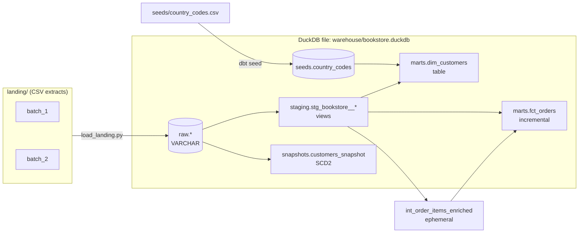

# 01 — dbt + DuckDB

> Weight: 🟢 light (~400 MB image, < 500 MB RAM) · one container · runs fully offline after the first build

A small online bookstore (`customers`, `books`, `orders`, `order_items`) modeled with dbt on top of DuckDB:
raw landing → staging → intermediate → marts, with tests, docs, an incremental fact table and an SCD2 snapshot.

## 1. What this example teaches

- How a dbt project is organized and how `ref()` / `source()` build the DAG
- The **staging → intermediate → marts** layering convention
- Materializations: `view`, `table`, `ephemeral`, `incremental` — and when to pick each
- Data tests: generic (built-in and custom), singular, severity levels, source freshness
- **Incremental models** with `unique_key` + merge, and the late-arriving data problem
- **Snapshots** (SCD type 2): `timestamp` vs `check` strategies, `hard_deletes`
- Seeds, macros/Jinja, `generate_schema_name`, docs and exposures
- DuckDB as a zero-infra local analytical engine

## 2. Key concepts

### dbt in one paragraph
dbt is the **T** of ELT. It does not move data: you write `SELECT` statements, and dbt wraps them in the DDL/DML
needed to materialize them (`create view`, `create table as`, `merge into`...) in dependency order.
`{{ ref('model') }}` and `{{ source('src', 'table') }}` are how dbt learns the dependencies — never hardcode table names.

### Coming from Databricks

| You know (Databricks / Spark) | dbt / DuckDB equivalent |
|---|---|
| Notebook/job cells run in a hand-ordered sequence | Models declare dependencies with `ref()`; dbt infers the DAG and runs it in parallel |
| Unity Catalog external table pointing to landing data | `source` (declared in YAML, with freshness checks) |
| `CREATE OR REPLACE TABLE ... AS SELECT` | `materialized='table'` |
| Temp view / CTE reused across cells | `materialized='ephemeral'` (inlined as a CTE, never exists in the DB) |
| `MERGE INTO target USING updates ON key` | `materialized='incremental'` + `unique_key` + `incremental_strategy='merge'` |
| Hand-written SCD2 MERGE with `is_current`, `valid_from/to` | `snapshot` — dbt generates the SCD2 logic |
| DLT expectations (`@dlt.expect`) | dbt data tests (`unique`, `not_null`, `relationships`, custom) |
| Unity Catalog lineage | `dbt docs` lineage graph + `exposures` |
| Spark SQL on a cluster | DuckDB: in-process, single-node, columnar, vectorized — the "SQLite of analytics" |

### Layers
- **staging** (`stg_<source>__<table>`): 1:1 with a source table. Rename, cast, clean, dedup. No joins. Views.
- **intermediate** (`int_...`): reusable logic between staging and marts (joins, reshaping). Here: ephemeral.
- **marts** (`dim_` / `fct_`): business-facing tables at a clear grain. Tables or incremental.

### Materializations
| | Stored? | Rebuilt on every run? | Use when |
|---|---|---|---|
| `view` | definition only | query runs at read time | light transforms, staging |
| `table` | yes | fully | marts that are cheap to rebuild |
| `ephemeral` | no (CTE) | n/a | small reusable logic, not queried directly |
| `incremental` | yes | only new/changed rows | large or append-heavy facts |
| `snapshot` | yes | appends history | tracking changes of a mutable source (SCD2) |

### Tests
A test is a query that returns **failing rows** — zero rows means pass. Generic tests are parameterized macros
(`unique`, `not_null`, `accepted_values`, `relationships`, or your own `test_<name>` macro); singular tests are
one-off `.sql` files in `tests/`. `severity: warn` reports without failing the build. `dbt build` runs models and
their tests in DAG order, so a failing test **skips everything downstream**.

### Incremental + late-arriving data
On the first run (or `--full-refresh`) an incremental model builds the whole table. On later runs,
`is_incremental()` is true and you filter only new rows — usually `where updated_at > (select max(updated_at) from {{ this }})`.
The filter column matters: filtering on `ordered_at` misses an order that was placed earlier but only arrived now
(order 36 in `batch_2`). Common mitigations: filter on an ingestion/update timestamp, or use a lookback window.

### Snapshots (SCD2)
- `timestamp` strategy: a row changed if `updated_at` is newer. Cheap, but trusts the source to bump `updated_at`.
- `check` strategy: compares the values of `check_cols`. Catches silent updates, costs more.
- dbt adds `dbt_valid_from`, `dbt_valid_to` (null = current version), `dbt_scd_id`, `dbt_updated_at`.

### The data and its traps
`scripts/load_landing.py` plays the role of the ingestion tool (Fivetran/Airbyte/dlt) and lands CSVs from
`landing/` into the `raw` schema, all as VARCHAR:
- `customers`, `books`: full extract — the table is replaced on each load
- `orders`, `order_items`: append-only — a status change arrives as a new row with a newer `updated_at`

`batch_2` contains deliberate surprises: tier upgrades, a customer who moved country, a changed email, a
change **without** a bumped `updated_at`, status updates for existing orders, new customers, and a late-arriving
order. `batch_1` also hides a data quality issue for the tests to find.

## 3. Architecture



## 4. How to run

```bash
make up            # build image + start container
make run           # load batch_1 -> dbt seed -> dbt build
make load-batch2   # land the second batch, then: make build
make docs          # http://localhost:8080 (Ctrl+C to stop)
make down
```

Useful commands:

```bash
make help                                              # all targets
make show Q="select * from {{ ref('dim_customers') }}" # ad-hoc query through dbt
make dbt ARGS="ls --select +dim_customers"             # any dbt command (here: node selection)
make dbt ARGS="build --select stg_bookstore__orders+"  # a model and everything downstream
make dbt ARGS="build --full-refresh"                   # rebuild incrementals from scratch
make freshness                                         # source freshness check
make shell                                             # bash inside the container
make reset                                             # delete the DuckDB file and dbt artifacts
```

Inspect what dbt generated: `bookstore/target/compiled/` (your SQL with Jinja resolved) and
`bookstore/target/run/` (the actual DDL/DML dbt executed).

## 5. Exercises

What already works: sources, `stg_bookstore__customers`, `stg_bookstore__orders` (with dedup), the seed,
`dim_customers` and their tests. Everything marked `TODO` is yours. Exercise files are disabled with
`{{ config(enabled=false) }}` — remove that line when you start. Run `make build` after each step.

1. **Staging** — implement `stg_bookstore__books` and `stg_bookstore__order_items`. Document both in `_bookstore__models.yml` with PK tests.
2. **Intermediate + fact** — implement `int_order_items_enriched` and `fct_orders` (as a `table` first). Look at `target/compiled/` and find where the ephemeral model went.
3. **Tests** —
   - add `relationships` tests (order_items → orders, order_items → books, fct_orders → dim_customers);
   - implement the custom generic test `positive_values` (`macros/tests/`) and apply it to `quantity`: it will find something — decide whether to fix it in staging, filter it, or set `severity: warn`, and write down why;
   - implement the singular test `tests/assert_order_amount_matches_items.sql`.
4. **Incremental** — convert `fct_orders` to `incremental` (`unique_key='order_id'`, strategy `merge`).
   Run `make build`, then `make load-batch2` and `make build` again. Verify: orders 20–25 have the new status, order 36 is there, and there are no duplicates.
   Then break it on purpose: filter on `ordered_at` instead of `updated_at` and see what you lose. Compare with `delete+insert` and `append` strategies.
5. **Snapshot (SCD2)** — finish `snapshots/customers_snapshot.yml` with the `timestamp` strategy. Snapshot batch_1, load batch_2, snapshot again.
   What happened to customer 5? Switch to the `check` strategy (`make reset && make run` to start over) and compare.
   Bonus: build `dim_customers_history` on top of the snapshot with an `is_current` flag.
6. **Point-in-time join** (bonus) — add the customer's tier *at the time of the order* to `fct_orders` using the snapshot validity window.
7. **Docs** — describe every mart column, add a `` block for the order status values, add an `exposure` for a "Sales dashboard", then `make docs` and explore the lineage graph.
8. **Materializations** — switch `stg_bookstore__orders` between `view`, `table` and `ephemeral`. For each, check `target/run/` and `information_schema.tables` (`make show Q="select table_schema, table_name, table_type from information_schema.tables"`).

Log what broke and how you fixed it in [NOTES.md](NOTES.md).

## 6. Interview questions

1. What is the difference between `ref()` and `source()`, and why should you never hardcode table names in dbt?
2. Walk me through the materializations. When would you choose `view` over `table`? What are the risks of `ephemeral`?
3. How does an incremental model work? What happens on the first run, on `--full-refresh`, and when the schema changes (`on_schema_change`)?
4. How do you handle late-arriving data in an incremental model?
5. `merge` vs `delete+insert` vs `append` vs `microbatch` — trade-offs?
6. Explain SCD types 1 and 2. How do dbt snapshots implement SCD2? `timestamp` vs `check` strategy — when does `timestamp` silently miss changes?
7. Why are snapshots usually built on top of sources rather than on transformed models?
8. Generic vs singular tests. What does `dbt build` do when a test fails upstream?
9. How would you organize a dbt project for a team of 20 engineers? (layers, naming, ownership, CI with `state:modified+` / slim CI)
10. What is `generate_schema_name` for, and how do dev/prod targets avoid stepping on each other?
11. When is a seed the wrong tool?
12. Why is DuckDB fast for analytics on a laptop, and where does it stop being the right choice compared to Spark?
