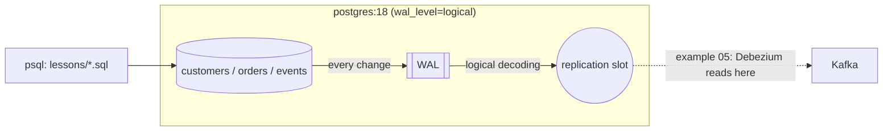

# 02 — Postgres for data engineers

> Weight: 🟢 light (~300 MB RAM) · one container · first start seeds 50k customers + 1M orders (~20 s)

Postgres is the most common **source system** a data engineer extracts from — and often the first warehouse.
This example is not about being a DBA: it is about the internals that decide whether your pipelines are fast,
correct and safe for the source: query plans, indexes, MVCC, WAL, replication slots, partitioning and bulk loading.

## 1. What this example teaches

- Reading `EXPLAIN (ANALYZE, BUFFERS)`: estimated vs actual rows, scan types, buffers
- Choosing indexes: B-tree (single, composite, covering), partial, expression, BRIN, GIN on `jsonb`
- MVCC: tuple versions, dead tuples, `VACUUM` vs `VACUUM FULL`, HOT updates, why long transactions hurt
- WAL and **logical replication slots** — the mechanism behind CDC (example 05)
- Declarative partitioning, partition pruning and instant retention
- Loading data: `COPY`, idempotent upserts with `ON CONFLICT`, `MERGE ... RETURNING`, delete+insert by window

## 2. Key concepts

### Coming from Spark / Delta

| Spark / Delta | Postgres |
|---|---|
| Data skipping with min/max stats, Z-order | BRIN index (min/max per block range), B-tree indexes |
| `OPTIMIZE` + `VACUUM` remove old files | `VACUUM` reclaims dead tuples left by MVCC; `VACUUM FULL` rewrites the table |
| Delta transaction log (`_delta_log`) | WAL (write-ahead log) — every change is logged before it hits the table |
| Change Data Feed | Logical decoding through a replication slot |
| Partitioned table + partition pruning | Declarative partitioning + partition pruning (same idea, row store) |
| `MERGE INTO` | `MERGE` (PG15+) or `INSERT ... ON CONFLICT` |

### EXPLAIN in 30 seconds
Read plans **bottom-up / inside-out**. For each node compare `rows=` (estimate) with `actual ... rows=`:
a big gap means bad statistics (`ANALYZE`) and usually a bad plan. `Buffers: shared hit` = pages from cache,
`read` = pages from disk. Scan types: `Seq Scan` (whole table), `Index Scan` (index + heap),
`Index Only Scan` (index only — needs a fresh visibility map), `Bitmap Heap Scan` (many matches, read pages in order).

### Index rules of thumb
- Composite index: **equality columns first, then range / sort columns**.
- Low-selectivity predicates (`status = 'delivered'` on 50% of rows) are better served by a seq scan.
- `WHERE f(col) = x` needs an index on `f(col)`.
- `INCLUDE (cols)` makes a covering index → index-only scans.
- Every index slows down writes and takes space: CDC sources and ingestion tables should have few.

### MVCC
An `UPDATE` writes a new row version and marks the old one dead (`xmax`). Readers never block writers.
The cost: dead tuples (bloat) that `VACUUM` must clean. A long-running transaction (an analyst's open session,
a stuck extraction) holds back the cleanup horizon for the **whole database**.

### WAL and replication slots
Every change is appended to the WAL first (durability + replication). A **logical replication slot**
decodes the WAL into row-level changes and remembers how far its consumer has read (`confirmed_flush_lsn`).
Postgres keeps every WAL segment the slot still needs — an abandoned slot will fill the disk. That is the
#1 production incident with CDC. `REPLICA IDENTITY` controls how much of the old row is logged on UPDATE/DELETE.

### Partitioning
A partitioned table routes rows to child tables by key. Queries filtering on the key skip partitions (pruning);
retention becomes `DETACH` + `DROP` (instant, no dead tuples) instead of a huge `DELETE`.
Constraint: every unique key must include the partition key.

## 3. Architecture



## 4. How to run

```bash
make up              # start Postgres (first time seeds the data)
make run             # run all 5 lessons and read the output top to bottom
make lesson N=03     # run a single lesson
make exercise N=01   # run your exercise file
make psql            # interactive psql
make down            # stop (keeps data) · make clean  # stop and delete the volume
```

Lessons: `01_explain_and_indexes`, `02_mvcc_and_vacuum`, `03_wal_and_replication_slots`, `04_partitioning`,
`05_bulk_load_and_upsert`. They are idempotent — re-run them as often as you want.

## 5. Exercises

Each file in `exercises/` sets up a scenario and leaves `TODO`s. Answer the "why" questions in [NOTES.md](NOTES.md).

1. **`ex01_query_tuning`** — make the "customer orders page" query sub-millisecond; justify column order; test `INCLUDE` and a partial index.
2. **`ex02_why_no_index`** — four queries that ignore an existing index. Explain each and fix it (`pg_trgm` is your friend for c).
3. **`ex03_cdc_slot`** — publication + `pgoutput` slot + replica identity + a slot-lag monitoring query. You'll reuse this in example 05.
4. **`ex04_partition_migration`** — migrate the 1M-row `orders` table to monthly partitions, in batches, with an atomic swap.
5. **`ex05_idempotent_loader`** — an idempotent daily aggregate with `ON CONFLICT` and with `MERGE`; handle rows that must disappear.

Bonus: open `pg_stat_statements` after running everything — which statements cost the most total time?

## 6. Interview questions

1. How do you read an execution plan? What does a large gap between estimated and actual rows tell you?
2. Composite index on `(a, b)`: which queries can use it? Does `WHERE b = ?` use it?
3. When does Postgres choose a seq scan over an index scan, and when is that the right choice?
4. What is MVCC? What causes table bloat and how do you fix it in production without downtime?
5. Why can a long-running transaction hurt the whole database?
6. What is the WAL? What is an LSN?
7. How does logical replication / CDC work in Postgres? What is a replication slot and what risk does it carry?
8. What does `REPLICA IDENTITY FULL` change for a CDC consumer, and what does it cost?
9. Why partition a table? What are the limitations of partitioning in Postgres?
10. How would you extract a 500M-row table from a production OLTP database without hurting it?
11. `INSERT ... ON CONFLICT` vs `MERGE` — differences? How do you make a load idempotent?
12. Why is `COPY` so much faster than batched INSERTs?
