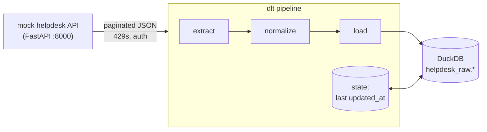

# 03 — Incremental API ingestion with dlt

> Weight: 🟢 light (~400 MB RAM) · two containers (mock API + pipeline) · no internet needed after the build

Ingest a (mock) SaaS helpdesk API into DuckDB with [dlt](https://dlthub.com/docs): paginated, authenticated,
rate-limited, **incremental** (only what changed since the last run), merged by primary key, with automatic
schema inference and evolution.

## 1. What this example teaches

- What an EL tool actually does: pagination, auth, retries, normalization, typing, loading, state
- Write dispositions: `append`, `replace`, `merge` — and when to use each
- Incremental loading with a cursor (`updated_at`), inclusive boundaries and dedup
- Where pipeline state lives and how a pipeline recovers it
- Nested JSON → child tables, schema evolution and schema contracts
- Soft deletes vs hard deletes in a merge
- Keeping secrets out of code (`dlt.secrets` + env vars)

## 2. Key concepts

### Why dlt
Managed EL tools (Fivetran, Airbyte, Stitch) are services you configure; dlt is a **Python library** you
embed in your own code/orchestrator. It is the code-first answer to "write a connector for this API":
you describe the endpoints, dlt does the rest. Comparable to writing a Spark job that calls an API and
`MERGE`s into Delta — minus the boilerplate for pagination, retries, schema and state.

### The mock API (`api/main.py`)
| Endpoint | Behaviour |
|---|---|
| `GET /api/v1/customers?page=` | page-number pagination, `total_pages` in the body |
| `GET /api/v1/tickets?updated_since=&cursor=` | cursor pagination, incremental filter (inclusive `>=`), sorted by `updated_at` |
| `GET /api/v1/tickets/{id}/comments` | child endpoint (exercise 1) |
| every 7th request | `429 Too Many Requests` + `Retry-After: 1` |
| `POST /admin/simulate` | updates 30 tickets, inserts 20, soft-deletes 5 (`deleted=true`) |
| `POST /admin/schema-v2` | tickets gain a nested `sla` object |

Swagger UI: http://localhost:8000/docs

### Write dispositions
| Disposition | What happens | Use for |
|---|---|---|
| `append` | add rows | immutable events, logs |
| `replace` | swap the whole table | small dimensions, full extracts |
| `merge` | upsert by `primary_key` (or `merge_key`) | mutable entities fetched incrementally |

### Incremental loading
`updated_since` is declared as `incremental` with `cursor_path: updated_at`. On each run dlt sends the last
seen value, then stores the new max in the **pipeline state**. Because the API filter is inclusive (`>=`),
the boundary rows come back on the next run — dlt dedups them, and `merge` makes it safe anyway.
The state is kept locally (`.dlt/pipelines/`) **and** in the destination (`_dlt_pipeline_state`), so a fresh
container can resume where the last one stopped.

### Normalization and schema
JSON lists become child tables (`tickets__tags`, linked by `_dlt_parent_id`), nested objects are flattened
(`sla__priority`). New fields evolve the schema automatically; `schema_contract` lets you `freeze` it instead —
the same trade-off as Delta `mergeSchema` vs enforced schemas.

### Secrets
`dlt.secrets["sources.helpdesk.api_token"]` resolves from the env var `SOURCES__HELPDESK__API_TOKEN`
or from `.dlt/secrets.toml` (git-ignored). The token here is a dummy for the local mock API.

## 3. Architecture



## 4. How to run

```bash
make up          # build + start the API and the pipeline container
make run         # 1st run: full history (1000 tickets)
make inspect     # tables, row counts, load history, incremental cursor
make simulate    # API changes data
make run         # 2nd run: only the 55 changed rows
make schema-v2   # API starts sending a nested `sla` object
make simulate && make run && make inspect   # schema evolved (_dlt_version has 2 rows)
make reset       # delete warehouse + local state (also `make down up` to reset the API's memory)
make down
```

## 5. Exercises

1. **Child resource** — add `ticket_comments` (`tickets/{resources.tickets.id}/comments`) to the source config,
   carrying the parent id. Get rid of the "Fallback paginator" warnings by declaring the right paginator.
2. **Deletes** — after `make simulate`, 5 tickets are soft-deleted. Decide: keep them flagged, or remove them from
   the destination with the `hard_delete` column hint. Implement it and justify the choice in NOTES.md.
3. **Schema contracts** — `make schema-v2`, then run with `schema_contract={"columns": "freeze"}`. What fails?
   Try `discard_value` and `discard_row`. Which one would you use in production for a revenue table?
4. **State** — delete `.dlt/pipelines/` and run again: what does dlt do and where does the state come from?
   Then backfill only September with `initial_value` + `end_value`, and do a full reload with `refresh="drop_sources"`.
5. **Under the hood** — rewrite `tickets` as a plain `@dlt.resource` using `RESTClient` and `dlt.sources.incremental`.
   What does the declarative config do for you?
6. **Another destination** — load the same source to the `filesystem` destination as Parquet
   (`warehouse/lake/`). Look at the layout. How would that land in S3/ADLS?
7. **Rate limits** — set `RATE_LIMIT_EVERY=2` on the API. Watch the retries and tune `RUNTIME__REQUEST_MAX_ATTEMPTS`.

## 6. Interview questions

1. How do you design incremental extraction from an API? What if the API has no `updated_since` filter?
2. Inclusive vs exclusive cursor boundaries: what can go wrong with each?
3. Where should pipeline state live? What happens if the state and the destination disagree?
4. `append` vs `replace` vs `merge` — which for events, dimensions, mutable entities?
5. How do you handle deletes when the source API only returns active records?
6. How do you deal with rate limits, retries and idempotency in an extraction job?
7. A source adds a field — what should happen? And if it changes a type? (schema evolution vs contracts)
8. How do you backfill a year of history without hurting the source API?
9. Build vs buy: when dlt/custom code instead of Fivetran/Airbyte?
10. How would you test an ingestion pipeline?
