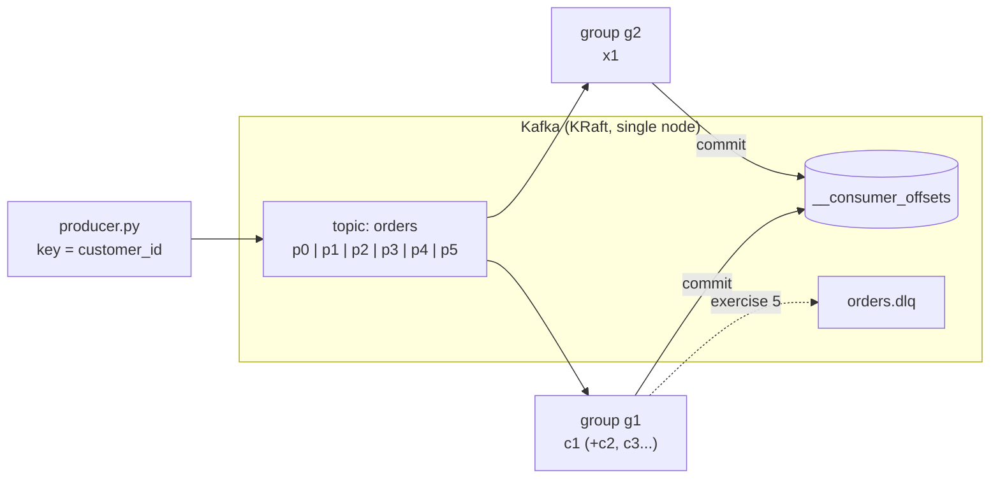

# 04 — Kafka fundamentals

> Weight: 🟡 medium (~350 MB RAM; +400 MB with the optional UI) · Kafka 4.3 in KRaft mode (no ZooKeeper) + Python app

The mental model every streaming and CDC system builds on: topics, partitions, keys, offsets, consumer groups,
delivery semantics and what really happens when a consumer dies.

## 1. What this example teaches

- Topics, partitions, replication factor, retention vs compaction
- Keys → partitions → per-key ordering
- Consumer groups, partition assignment, rebalances, `session.timeout.ms`
- Offsets, commits and lag — and how to rewind (replay)
- At-most-once vs at-least-once vs exactly-once; idempotent producer; idempotent consumers
- Dead-letter queues for poison messages
- KRaft: Kafka without ZooKeeper (the only mode since Kafka 4.0)

## 2. Key concepts

### Coming from Spark / Databricks
| You know | Kafka |
|---|---|
| Delta table as an append-only log of commits | A **topic** = append-only, partitioned, replicated log |
| Spark partitions = unit of parallelism | Kafka partitions = unit of parallelism **and** ordering |
| Structured Streaming checkpoint (offsets per partition) | Consumer group **committed offsets** (stored in `__consumer_offsets`) |
| Auto Loader `cloudFiles` reads new files once | A consumer group reads each message once per group |
| `VACUUM` retention | `retention.ms` / `retention.bytes` (delete) or `cleanup.policy=compact` |

### Partitions and keys
The producer hashes the **key** to pick a partition, so all events of the same key land in the same partition,
**in order**. No key → the producer spreads messages (sticky partitioner). Ordering is only guaranteed
**within a partition**. Number of partitions = max parallelism of a consumer group; increasing it later
changes the key→partition mapping.

### Consumer groups
Consumers sharing a `group.id` split the partitions between them; each partition goes to exactly one member.
Different groups are independent (each keeps its own offsets) — that's how many systems read the same topic.
When members join/leave, the group **rebalances**. A member that crashes keeps its partitions until
`session.timeout.ms` expires — step 7 of `make run` shows that wait.

### Offsets and delivery semantics
- **At-most-once**: commit before processing. A crash loses messages.
- **At-least-once**: process, then commit (this example). A crash re-delivers everything since the last commit → **duplicates**.
- **Exactly-once**: either Kafka transactions (read-process-write within Kafka), or at-least-once + an
  **idempotent sink** (upsert by a unique event id). The second is what most real pipelines do.

The **idempotent producer** (`enable.idempotence=true`) is a different thing: it prevents duplicates caused by
producer retries, using producer id + sequence numbers.

### Compaction
`cleanup.policy=compact` keeps at least the latest value per key; a `null` value (tombstone) deletes the key.
A compacted topic behaves like a table changelog — the basis of KTables and of Debezium's topics.

## 3. Architecture



## 4. How to run

```bash
make up              # Kafka + app container (make up-ui adds Kafka UI on :8080)
make run             # guided demo: produce, consume, lag, second group, crash + redelivery
make rebalance-demo  # 3 consumers in one group share 6 partitions
make groups          # kafka-consumer-groups.sh --describe --all-groups
make down
```

Interactive: open 3 terminals and run `make consume GROUP=live NAME=c1 ARGS=--forever` (c2, c3...),
then `make produce N=2000` in a 4th one and watch the assignments and rebalances.

From the host, clients connect to `localhost:29092`; inside Docker, to `kafka:9092` (two listeners — see the compose file).

## 5. Exercises

1. **Keys and ordering** — `make produce N=200 ARGS=--no-key`. How are partitions picked now? Is per-customer
   ordering still guaranteed for the consumer? When would you choose no key on purpose?
2. **Scaling a group** — run 1, 3, 6 and 7 consumers in the same group. What does the 7th do? Switch the
   assignor to `range` and compare a rebalance with `cooperative-sticky`.
3. **Delivery semantics** — change `consumer.py` to at-most-once (commit before processing). Repeat the crash
   demo: what is lost now? Write down when each semantic is acceptable.
4. **Idempotent consumer** — implement `process()` writing to SQLite/DuckDB with `event_id` as primary key
   (upsert). Re-run the crash demo and prove the sink has no duplicates although Kafka re-delivered.
5. **Dead-letter queue** — `make produce N=10 ARGS="--poison 3"`. Today the consumer crashes; implement
   `handle_poison()` to send the raw payload + error + original partition/offset to `orders.dlq`. Why must you
   commit **after** the DLQ write?
6. **Replay** — `make reset-offsets GROUP=g1 TO="--to-datetime 2026-01-01T00:00:00.000"` and other options
   (`--shift-by -100`, `--to-offset`). Why must the group be inactive?
7. **Compaction** — write `customers_producer.py` that sends several updates per key + a tombstone to
   `customers.latest`; wait ~30 s and consume from the beginning. What survived and why?
8. **Exactly-once inside Kafka** (bonus) — read `orders`, enrich, write `orders.enriched` with a transactional
   producer (`transactional.id`, `send_offsets_to_transaction`) and a consumer with `isolation.level=read_committed`.

## 6. Interview questions

1. How does Kafka guarantee ordering? How would you guarantee ordering per customer?
2. How do you choose the number of partitions? What happens if you increase it later?
3. Explain consumer groups and rebalancing. What triggers a rebalance? What is cooperative rebalancing?
4. At-most-once, at-least-once, exactly-once: how is each achieved? Which one do you actually use?
5. What does `enable.idempotence` do? What does `acks=all` + `min.insync.replicas` guarantee?
6. What is consumer lag and how do you monitor/alert on it?
7. How do you handle poison messages?
8. Retention vs compaction — when do you use each? What is a tombstone?
9. Why did Kafka remove ZooKeeper? What is KRaft?
10. A consumer is slow and the lag keeps growing. What do you check, and what are your options?
11. Kafka vs a queue (SQS/RabbitMQ) vs Kinesis/Event Hubs — when to pick each?
