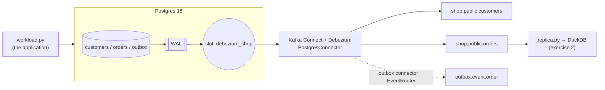

# 05 — CDC with Debezium (Postgres → Kafka)

> Weight: 🟡 medium-heavy (~2 GB RAM, first `make up` ~2 min) · Postgres 18 + Kafka 4.3 + Debezium 3.6 (Kafka Connect) + Python app

Change Data Capture: stream every insert, update and delete from an OLTP database into Kafka, in commit order,
without touching the application and without polling queries. Builds directly on example 02 (WAL, slots,
replica identity) and example 04 (topics, keys, compaction).

## 1. What this example teaches

- Log-based CDC vs query-based (`updated_at`) extraction
- Kafka Connect: workers, connectors, tasks, REST API, offsets stored in Kafka
- The Debezium Postgres connector: `pgoutput`, publication, slot, initial snapshot, streaming
- The change event envelope: `op`, `before`, `after`, `source`, `ts_ms`, tombstones
- Replica identity and its effect on `before`
- Applying a CDC stream to a replica idempotently (exercise 2)
- The transactional **outbox pattern** with the EventRouter SMT (exercise 3)

## 2. Key concepts

### Log-based vs query-based
`select * where updated_at > :last` misses **hard deletes**, misses intermediate states, needs an index and
a trustworthy `updated_at`, and loads the source. Log-based CDC reads the WAL: every committed change,
deletes included, in order, with minimal load. Cost: operational complexity (slots, connectors, schemas).

### The pieces
```
Postgres WAL -> publication (which tables) -> replication slot (position) -> Debezium connector
             -> Kafka Connect worker -> topics <prefix>.<schema>.<table> (key = primary key)
```
Kafka Connect stores connector configs, source offsets (the LSN) and status in Kafka topics
(`connect_configs`, `connect_offsets`, `connect_statuses`) — restart the worker and it resumes.

### Change event envelope
```json
{"before": {...} | null, "after": {...} | null,
 "op": "r|c|u|d", "ts_ms": 1790000000000,
 "source": {"lsn": 29503472, "txId": 790, "table": "orders", "snapshot": "false", ...}}
```
`r` = snapshot read, `c` create, `u` update, `d` delete. After a delete, Debezium also emits a **tombstone**
(same key, `null` value) so compacted topics can forget the key.

### Snapshot then stream
On first start (`snapshot.mode=initial`) the connector reads all existing rows (op=`r`) at a consistent point,
then streams from the slot. Other modes: `no_data` (stream only), `when_needed`, incremental snapshots via
signals (re-snapshot a table without stopping the stream).

### Replica identity
`orders` has `REPLICA IDENTITY FULL` → its updates carry the full `before`. `customers` keeps the default →
`before` is `null` on updates (the demo shows both). FULL costs extra WAL; you need it for diffs and for
sinks that match on non-key columns.

### Outbox pattern
Dual writes (write DB, then publish to Kafka) are not atomic — one can fail. Instead, the service writes the
business row **and** an `outbox` row in the same transaction; Debezium captures the outbox table and the
EventRouter SMT turns each row into a clean domain event (`outbox.event.order`, key = aggregate id).

### Coming from Databricks
Debezium topics are what Lakeflow Connect / DLT `APPLY CHANGES` (now `AUTO CDC`) consume: the sink side
(exercise 2) is exactly an `APPLY CHANGES INTO` / `MERGE` keyed by the primary key, ordered by LSN.

## 3. Architecture



## 4. How to run

```bash
make up              # ~2 min the first time (images), ~2 GB RAM
make run             # register connector -> snapshot -> live changes -> slot
make workload        # more changes; then: make watch
make status          # connector + task state     · make topics
make slot            # replication slot + retained WAL
make logs            # Kafka Connect logs (when a connector fails, the answer is here)
make down
```

Kafka Connect REST: `curl localhost:8083/connectors/shop-connector/status`.

## 5. Exercises

1. **Failure modes** — `docker compose stop connect`, run `make workload` a few times, then `make slot`: what happens
   to `retained_wal`? Start it again: are any events lost? Now delete the connector and look at the slot — what must
   you do by hand?
2. **CDC sink / replica** — implement `apply()` in `app/replica.py` (upsert on c/r/u, delete on d, ignore
   tombstones, idempotent). `make replica`, `make workload`, `make replica`, then `make verify-replica`.
   Re-run from scratch twice (`duckdb-replica` group reset) and prove the result is identical.
3. **Outbox** — complete the EventRouter SMT in `connectors/outbox-connector.json` and run `make outbox`.
   The event must land on `outbox.event.order`, key = order id, value = the JSON payload only.
   Why is this safer than producing to Kafka from the application?
4. **Schema change** — `alter table orders add column channel text default 'web'` and update a row. What does the
   event look like? Then drop a column. How would a downstream Delta/Iceberg table cope? (Schema Registry + Avro is
   the production answer — why?)
5. **Replica identity** — set `REPLICA IDENTITY FULL` on `customers` and compare an update event before/after.
6. **Re-snapshot** — add `public.outbox` to `table.include.list` of the shop connector and trigger an incremental
   snapshot through a signal table (`signal.data.collection`). Read the docs, make it work, explain when you'd need it.

## 6. Interview questions

1. Log-based vs query-based CDC: trade-offs? Why do `updated_at` extractions miss data?
2. How does Debezium read Postgres? What are the publication and the replication slot for?
3. What happens if the Debezium connector is down for 2 days? And if it is deleted without dropping the slot?
4. What delivery guarantee does Debezium give? How do you make the sink correct anyway?
5. How do you handle deletes downstream (tombstones, soft deletes, `op=d`)?
6. What is the initial snapshot and how do you re-snapshot a single table in production?
7. How do schema changes propagate through CDC? What role does a schema registry play?
8. Explain the transactional outbox pattern. What problem does it solve?
9. How would you land CDC data into a lakehouse (Delta/Iceberg) and keep it queryable as current state?
10. Ordering: is it guaranteed across tables? Within a table? Within a key?
