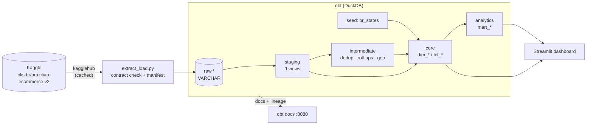
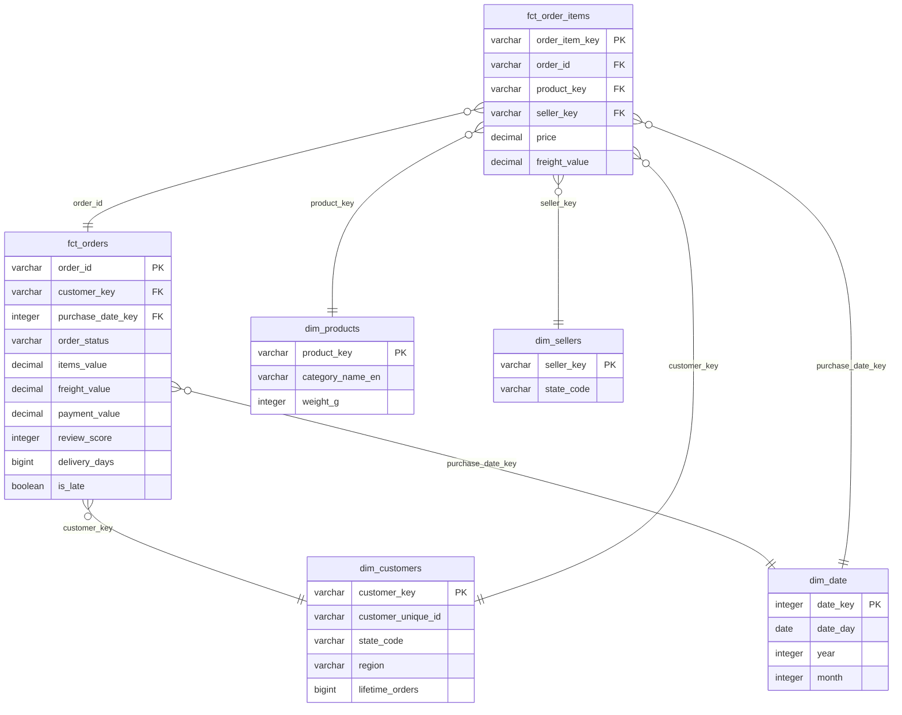

# 13 — Olist e-commerce data warehouse (portfolio project)

> Weight: 🟢 light (~650 MB RAM peak) · one container · real data: ~100k orders, 1.5M rows · full dbt build in ~10 s

An end-to-end, production-style **analytics data warehouse** built from a real dataset — the
[Brazilian E-Commerce Public Dataset by Olist](https://www.kaggle.com/datasets/olistbr/brazilian-ecommerce)
(Kaggle, CC BY-NC-SA 4.0). Extract → load raw → model a Kimball star schema with dbt → test → serve a dashboard,
with CI, linting, contracts, unit tests and architecture decision records.

Unlike the other folders of this lab (skeleton + exercises), this one is **complete**: a reference
implementation of good practices to study, copy and adapt.

## Highlights

| Practice | Where |
|---|---|
| Reproducible extraction: pinned dataset version, schema contract on the files, ingestion manifest with sha256 | [`ingestion/extract_load.py`](ingestion/extract_load.py) |
| Raw layer untouched (all VARCHAR) + typing in staging | [ADR 0003](docs/adr/0003-raw-layer-as-varchar.md) |
| Layered dbt project: staging → intermediate → core → analytics | [`olist_dbt/models`](olist_dbt/models) |
| Kimball star schema, explicit grains, surrogate keys, no fan-out joins | [ADR 0002](docs/adr/0002-kimball-star-schema.md) |
| Enforced **model contracts** on the main fact and dimension | [`_core__models.yml`](olist_dbt/models/marts/core/_core__models.yml) |
| **Unit tests** for business logic (dedup, payment roll-up) | [`_intermediate__models.yml`](olist_dbt/models/intermediate/_intermediate__models.yml) |
| 75 data tests with an explicit error/warn policy, failures stored for debugging | [ADR 0004](docs/adr/0004-data-quality-policy.md) |
| Docs with a custom overview page, doc blocks and an exposure for the dashboard | [`docs.md`](olist_dbt/models/docs.md) |
| SQL lint (sqlfluff, dbt templater) + Python lint/format (ruff) | `make lint` |
| CI on every push: lint + `dbt build --empty` (schema + unit tests) without data or secrets | [`.github/workflows/13-olist-dwh.yml`](../.github/workflows/13-olist-dwh.yml) |
| Dashboard reading only the marts, with a smoke test | [`dashboard/`](dashboard) |

## What the data says

Analysis window Jan/2017 → Aug/2018 (the edges of the dataset are partial).

| Finding | Number |
|---|---|
| GMV (sales orders, items only) | **R$ 13.5 M** over 98.2k orders · AOV **R$ 137** |
| Growth | Jan–Aug 2018 GMV is **2.4×** Jan–Aug 2017 · peak month Nov/2017 (Black Friday, 7.4k orders) |
| Late deliveries | **6.8%** of delivered orders arrive after the promised date |
| …and they destroy satisfaction | avg review **4.29** on time vs **2.27** late · **61%** of late orders get 1–2 stars (vs 9%) |
| Retention | only **3.1%** of customers ever buy twice · month-1 cohort retention **< 0.5%** |
| Seller concentration | **18%** of the sellers with sales (539 of 3,053) make **80%** of GMV |
| Geography | São Paulo gets orders in **8.7 days**, Roraima in **29.3** · freight is 21% of order value in the Southeast vs 29% in the North |
| Payments | credit card 75.5%, boleto 19.9%, voucher 3.1% |

## Data quality findings (and what the model does about them)

| Finding in the source | Handling |
|---|---|
| `customer_id` is generated **per order**; 99,441 ids for 96,096 real people (`customer_unique_id`) | `dim_customers` is keyed on `customer_unique_id` |
| ~1M geolocation rows for ~19k zip prefixes, some coordinates outside Brazil | `int_geolocation__zip_centroids`: median point inside Brazil's bounding box |
| 814 duplicated `review_id`s, 547 orders with several reviews | `int_order_reviews__latest`: latest answered review per order (unit tested) |
| Orders split across several payment methods | `int_order_payments__by_order`: roll-up + primary method by value (unit tested) |
| 255 orders where payments ≠ items + freight by more than R$ 1 (interest, vouchers) | singular test, **warn**, rows kept in `audit` |
| 8 orders `delivered` without a delivery date | `expression_is_true` test, **warn** |
| 610 products without category, 2 categories without translation | `coalesce` to the Portuguese name / `unknown` |
| Source columns with typos (`product_name_lenght`) | renamed once, in staging |
| Partial first/last months | `in_analysis_window` flag driven by project vars |

## Architecture



### Star schema



## How to run

```bash
make up              # build the image (~1 min the first time)
make run             # download (42 MB, no Kaggle account needed) -> load raw -> dbt deps -> dbt build
make dashboard       # http://localhost:8501
make docs            # http://localhost:8080 — lineage graph, column docs, tests
make lint            # sqlfluff + ruff
make ci              # what CI runs: empty raw tables -> dbt build --empty (contracts + unit tests)
make test-dashboard  # dashboard smoke test
make show Q="select * from {{ ref('mart_seller_scorecard') }} order by gmv_rank"
make down
```

The dataset is downloaded into `data/` and the warehouse is `warehouse/olist.duckdb` — both git-ignored.
Nothing from the dataset is committed to the repository.

## Project structure

```
13-olist-data-warehouse/
├── ingestion/extract_load.py      # extract (Kaggle) + load raw, contract check, manifest
├── olist_dbt/
│   ├── models/
│   │   ├── staging/olist/         # stg_olist__*: rename, cast, clean (views)
│   │   ├── intermediate/          # int_*: dedup, roll-ups, geo centroids (+ unit tests)
│   │   ├── marts/core/            # dim_*, fct_* (tables, contracts on the main ones)
│   │   ├── marts/analytics/       # mart_*: business questions (+ exposure)
│   │   └── docs.md                # doc blocks + docs overview page
│   ├── seeds/                     # br_states: static reference data
│   ├── tests/                     # singular tests
│   ├── analyses/                  # versioned ad-hoc SQL
│   └── .sqlfluff
├── dashboard/                     # Streamlit app + smoke test
├── docs/adr/                      # architecture decision records
└── Makefile · Dockerfile · docker-compose.yml · requirements.txt (pinned) · pyproject.toml (ruff)
```

## Taking it to production

What would change with a real team, a live source and a cloud budget:

- **Warehouse:** Snowflake/BigQuery/Databricks — change the dbt profile; replace DuckDB-specific functions
  (`arg_max`, `median`, `mode`) with dialect macros or `dbt_utils` cross-db helpers.
- **Ingestion:** CDC from the OLTP database (Debezium, Fivetran) instead of CSV dumps — see examples 03 and 05.
- **Incremental models:** `fct_orders` / `fct_order_items` as `incremental` with `unique_key` and a lookback
  window for late updates (example 01, exercise 4).
- **History:** `dim_customers` from a snapshot (SCD2) so reports can use the address at any point in time.
- **Orchestration:** Airflow/Dagster running ingest → `dbt build` → dashboard refresh, with retries and alerts.
- **CI/CD:** slim CI (`dbt build --select state:modified+ --defer`), per-PR schemas, prod deploys on merge.
- **Observability:** freshness SLAs, test results history, anomaly detection on row counts and on the warn-level tests.
- **Semantic layer:** metrics (GMV, AOV, late rate) defined once (dbt Semantic Layer / MetricFlow) instead of in each mart.
- **Governance:** model `access` + `groups`, contracts on every public model, PII tagging (zip, city).

## Study path through this project

1. Read the ADRs (`docs/adr/`) — the *why* before the *how*.
2. `make run`, then open the docs lineage graph and follow `fct_orders` back to the sources.
3. Read the staging models (casting), then the intermediate ones (each solves one data-quality finding above).
4. Read `fct_orders.sql` and explain why items and payments are aggregated before the join.
5. Break things on purpose: change a type in `fct_orders.sql` and watch the contract fail; change the dedup
   rule and watch the unit test fail; delete a column from a raw CSV header and watch ingestion fail.
6. Extend it: add an incremental `fct_order_items`, a `dim_customers` SCD2 via snapshot, or a `mart_category_trends`
   with its own tests and docs.

## Attribution

Data: *Brazilian E-Commerce Public Dataset by Olist*, available on Kaggle under
[CC BY-NC-SA 4.0](https://creativecommons.org/licenses/by-nc-sa/4.0/). The data is downloaded at run time and
is not redistributed in this repository.
