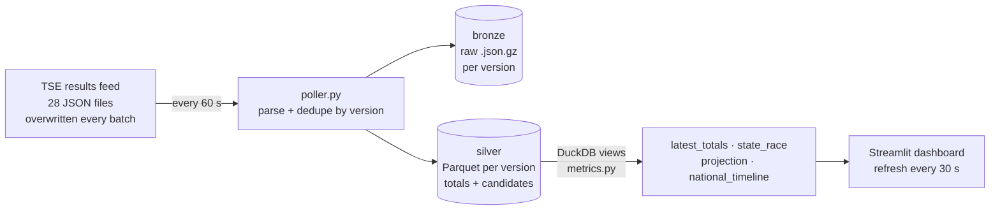
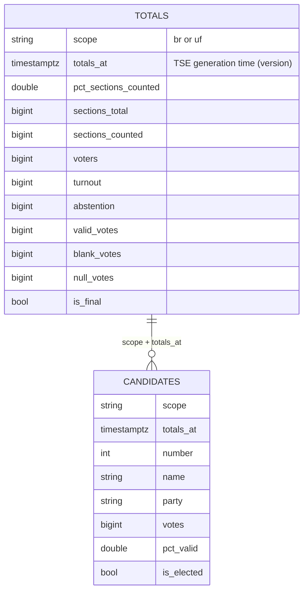

# 17 · Election night live: near-real-time pipeline on the TSE results feed

A small but complete **near-real-time data pipeline** built (and run) during the count of Brazil's
2026 presidential runoff: it polls the official results feed every minute, keeps **every version** of
it in a tiny local lakehouse, and serves a self-refreshing dashboard with a per-state projection.

> Weight: **light** (~400 MB RAM, no database server). Runs with Docker or a plain virtualenv.
> Data is not committed: it is collected at run time into `data/` (git-ignored).

---

## 1. What this example teaches

- **Polling an "overwrite-in-place" source** and turning it into an append-only history (the feed
  rewrites the same JSON every batch: if you do not keep versions, the evolution is lost forever).
- **Idempotent ingestion** keyed on the source's own version (scope + generation timestamp).
- **Bronze/silver on files**: raw JSON kept as published (replayable), typed Parquet per version.
- **Read-while-write without a database**: one immutable file per version + atomic rename, queried
  with DuckDB `read_parquet` globs.
- **Serving fresh data**: Streamlit fragments that re-run every 30 s.
- **Explainable estimation under bias**: early results are not a random sample (states report at
  different speeds) — a per-state projection corrects the biggest part of that.
- **Being a good citizen with public APIs** on their busiest night: low frequency, small pauses,
  per-scope error isolation.

## 2. Key concepts

| Concept | Here | Spark / Databricks analogy |
|---|---|---|
| Change capture by polling | `poller.py` compares the TSE generation time per scope | Auto Loader / a JDBC incremental read on a timestamp column |
| Immutable versions | one Parquet per (scope, version); totals file written last = commit marker | Delta commit files in `_delta_log` |
| Atomic publish | write `*.tmp`, then `rename` | Delta's optimistic commit |
| Bronze / silver | `data/bronze/<uf>/*.json.gz`, `data/silver/{totals,candidates}/*.parquet` | medallion layers |
| Latest state from history | `qualify row_number() over (partition by scope order by totals_at desc) = 1` | `MERGE`-maintained current table vs. CDF history |
| Time travel | the `national_timeline` view (every version) | `VERSION AS OF` |
| Near-real-time serving | Streamlit `@st.fragment(run_every=30)` | Databricks SQL dashboard with auto-refresh |

## 3. Architecture



Data model (silver):



## 4. How to run

```bash
make up        # builds one small image; starts the poller (60 s) and the dashboard
open http://localhost:8501
make logs      # watch versions arriving
make test      # 9 tests: parsing, idempotency, backfill, projection math, dashboard smoke test
make down
```

Without Docker:

```bash
uv venv && uv pip install -r requirements.txt
PYTHONPATH=src python -m election.poller &           # or --once
PYTHONPATH=src streamlit run dashboard/app.py
```

Already captured raw files elsewhere? `make backfill DIR=/path/with/json.gz` replays them through the
same code path (duplicates are skipped).

**Re-using it for another election**: the TSE publishes the same layout for every election; change
`ELECTION_CODE` (and the office code in the URL) in `src/election/feed.py`.

## 5. Exercises

1. **Votes per minute.** Add a view with the national counting speed (Δ sections / Δ time) and plot it.
   When did the count slow down, and why would that matter for a live projection?
2. **Better projection.** Weight each state's remaining votes by its 2022 runoff result instead of its
   current share. Compare both projections against the final result.
3. **Municipality level.** The TSE also publishes per-municipality files; extend the poller and model
   the capital-vs-interior bias the per-state projection cannot see.
4. **Compaction.** Hundreds of tiny Parquet files: write a job that compacts closed hours into one
   file per scope and keeps reads identical. (This is `OPTIMIZE` in Delta.)
5. **dbt on top.** Move `metrics.py` views into a dbt-duckdb project with tests (e.g. votes never
   decrease between versions of a scope; `pct_valid` sums to 100).
6. **Alerting.** Emit an event when the leader changes or a state passes 99% counted.

## 6. Interview questions

- The source overwrites one file per batch. How do you capture its history reliably, and how do you
  know two downloads are the same version?
- Why one file per version instead of appending to a single DuckDB/SQLite file that the dashboard reads?
- What makes a write "atomic" on a local filesystem vs. on S3? How do table formats solve it?
- Early results showed one candidate ahead and the final result flipped. Explain the statistics.
- What would change to serve this to 1 million concurrent users?
- How do you avoid being rate-limited or blocked by a public API during its peak?

---

## What the data showed on the night

Captured live on 2026-10-25 (Brasília time). Partial figures, recorded as they were published:

| TSE time | Sections counted | Lula | Flávio Bolsonaro |
|---|---|---|---|
| 20:46 | ~72.8% | 51.01% | 48.99% |
| 20:49 | 75.87% | 51.11% | 48.89% |
| 20:54 | 81.84% | 51.36% (51.9 M votes) | 48.64% (49.2 M votes) |

- **States report at very different speeds.** At 20:54, Rio de Janeiro had 36% of its sections counted
  and Sergipe 44%, while Ceará was at 86%. Comparing "who is ahead" across those states mixes very
  different stages of the count.
- **Per-state projection at 20:54:** Lula 51.46% / Flávio 48.54% (remaining votes split like each state's
  counted votes). The projection moved little because the large states still counting (RJ, SP) leaned to
  different sides and cancelled out.
- Prediction markets moved violently during the same hours (one side went from ~80% to ~5% in a few
  hours) — a reminder that early, non-random partial counts are easy to misread.

## Data, terms and caveats

- Source: TSE (Tribunal Superior Eleitoral), public results feed at `resultados.tse.jus.br`. Official
  results are the ones published by the TSE; this project is an independent study tool.
- The feed's format is not formally documented for third parties; field meanings are listed in
  `src/election/feed.py` and were checked against the official site.
- Only aggregated, public data (totals per state and candidate) is stored.

## Production notes

- Replace the local disk with object storage (S3/ADLS/GCS) and the per-version files with a table
  format (Delta/Iceberg) to get compaction, schema evolution and concurrent writers.
- Run the poller as a scheduled job with a heartbeat alert (no new version for N minutes during the
  count = page someone) — the TSE itself paused for over an hour at times on the night.
- Put a cache/CDN in front of the dashboard; never let user traffic hit the source.
