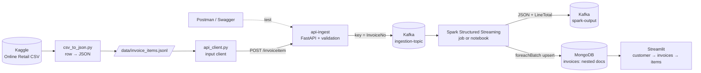

# 18 · Invoice streaming: API → Kafka → Spark Structured Streaming → MongoDB → Streamlit

An end-to-end streaming pipeline on real e-commerce invoices: every invoice line is posted to an HTTP API
**as it is created**, travels through Kafka, is processed by Spark Structured Streaming and lands in
MongoDB as a nested invoice document, which a Streamlit UI shows per customer and per invoice.

> Weight: **medium** (~3 GB RAM with everything up; Spark is about half). Kaggle data is downloaded
> at run time (no credentials needed) and never committed.



---

## 1. What this example teaches

- Preparing a dataset for streaming: **CSV row → JSON document**, replayed in creation order.
- An **ingestion API** in front of Kafka (FastAPI + pydantic): validate once, reject bad data with
  `422`, never let malformed messages into the stream; idempotent Kafka producer.
- **Kafka** in KRaft mode (no ZooKeeper), explicit topics, partitioning by key (`InvoiceNo`).
- **Spark Structured Streaming** reading Kafka with an explicit schema, writing to **two sinks**
  (Kafka and MongoDB) with separate checkpoints, bounded micro-batches (`maxOffsetsPerTrigger`).
- **At-least-once + idempotent sink = exactly-once results**: MongoDB upserts with `$addToSet`, so
  replays never duplicate items (tested by sending the whole dataset twice).
- **Document modeling** in MongoDB: invoice with embedded items, schema validation, indexes for the
  UI's queries, least-privilege users.
- A small **Streamlit** app over MongoDB aggregations, refreshing while data streams in.

## 2. Key concepts

| Concept | Here | Databricks / Spark analogy |
|---|---|---|
| Message key → partition | `InvoiceNo` as key: all lines of an invoice in order on one partition | `partitionBy` for ordering guarantees |
| Explicit schema on read | `from_json(value, ITEM_SCHEMA)` | Auto Loader with `schemaHints` / schema enforcement |
| Checkpoint | offsets committed only after the sink wrote the batch | the same mechanism, `checkpointLocation` on DBFS/UC volumes |
| `foreachBatch` | normal DataFrame per micro-batch → any sink (MongoDB bulk upsert) | `foreachBatch` + `MERGE INTO` for Delta upserts |
| Idempotent sink | `$set` header + `$addToSet` items | `MERGE` on a business key |
| Backpressure | `maxOffsetsPerTrigger = 5000` | `maxFilesPerTrigger` / `maxBytesPerTrigger` |
| Embedded documents | invoice with `items: [...]` | a struct/array column instead of a join table |

## 3. Architecture

| Service | Image | Port (localhost only) | Role |
|---|---|---|---|
| `kafka` | apache/kafka 4.3.1 (KRaft) | 29092 | broker + controller |
| `kafka-init` | apache/kafka 4.3.1 | – | creates `ingestion-topic` and `spark-output` (3 partitions) |
| `api-ingest` | python 3.12 + FastAPI | 8000 (`/docs`) | validates and produces to Kafka |
| `spark-stream` | spark 4.1.3 + Kafka connector baked in | – | the streaming job (`jobs/stream_invoices.py`) |
| `notebook` *(profile)* | same Spark image + JupyterLab | 8888 | the same job, cell by cell |
| `mongo` | mongo 8.0.32 | 27017 | invoices store (validator, indexes, users) |
| `mongo-express` *(profile)* | mongo-express 1.0.2 | 8081 | browse MongoDB |
| `dashboard` | python 3.12 + Streamlit | 8501 | customer → invoices → items |

MongoDB document:

```json
{
  "_id": "536365", "InvoiceNo": "536365", "CustomerID": "17850", "Country": "United Kingdom",
  "InvoiceDate": "2010-12-01T08:26:00Z", "IsCancellation": false,
  "items": [
    {"StockCode": "85123A", "Description": "WHITE HANGING HEART T-LIGHT HOLDER", "Quantity": 6, "UnitPrice": 2.55}
  ]
}
```

## 4. How to run

```bash
make up          # Kafka, MongoDB, API, Spark stream, dashboard (first build ~10 min)
make prepare     # Kaggle CSV -> data/invoice_items.jsonl (N=300 invoices by default; N=0 = all 541k lines)
make send        # input client POSTs every line to the API
open http://localhost:8501       # pick a customer, then an invoice
```

Watch it live: `make send-live` (20 lines/s) with the dashboard open.

| Command | What it shows |
|---|---|
| `make topics` | partitions and end offsets of both topics |
| `make consume-in` / `make consume-out` | raw messages before / after Spark |
| `make mongo-count` | invoices and items stored |
| `make logs` | Spark micro-batches (`batch N: items -> invoices`) |
| `make notebook` | JupyterLab with `notebooks/stream_invoices.ipynb` |
| `make up-ui` | Mongo Express on :8081 |
| `make test` | 13 unit tests (data prep, API, client retries, document model) |
| Postman | import `postman/api-ingest.postman_collection.json` (valid → 201, invalid → 422) |

`make down` stops everything (data stays in volumes); `make clean` also deletes MongoDB data and checkpoints.

## 5. Exercises

1. **Dead-letter topic.** Today invalid JSON in Kafka becomes NULLs and is dropped. Route those records
   to `ingestion-dlq` with the raw value and the error.
2. **Late lines.** Send an extra item for an invoice that is already in MongoDB. Does the UI update?
   Why does the document model make this easy?
3. **Windowed metrics.** Add a third sink: revenue per country per 10 minutes of `InvoiceDate`, with a
   watermark. What happens to lines that arrive after the watermark?
4. **Exactly-once to Kafka.** The Kafka sink is at-least-once. Show a duplicate in `spark-output` after a
   crash, then discuss how a consumer should de-duplicate.
5. **Scale out.** Run 2 Spark jobs in the same consumer group? (Trick question: Structured Streaming does
   not use consumer groups for offsets — explain what it uses and why.)
6. **Cancellations.** Invoices starting with `C` have negative quantities. Net them against the original
   sale in a "customer lifetime value" view.

## 6. Interview questions

- Why put an API in front of Kafka instead of letting clients produce directly?
- How does Structured Streaming achieve exactly-once *results* with an at-least-once sink?
- Where are the offsets of a Structured Streaming query stored? What happens if you delete the checkpoint?
- Embed or reference: when would you store items in a separate collection?
- What does `enable.idempotence=true` protect against, and what does it NOT protect against?
- How would you size partitions of `ingestion-topic` for 10× the traffic?
- KRaft vs. ZooKeeper: what changed operationally?

---

## Data

- **Online Retail** (UCI Machine Learning Repository, Daqing Chen et al.), Kaggle mirror
  `carrie1/ecommerce-data` (version 1): 541,909 invoice lines of a UK-based online gift retailer,
  Dec 2010 – Dec 2011, 4,372 customers, 38 countries. Licensed CC BY 4.0 by UCI.
- 541,909 lines, 25,900 invoices, 2010-12-01 → 2011-12-09.

Data-quality findings (checked with DuckDB on the full file):

| Finding | Size | How the pipeline handles it |
|---|---|---|
| Lines without `CustomerID` (guest checkouts) | 24.9% | stored with `CustomerID: null`; not listed in the customer picker |
| Cancellations (`InvoiceNo` starts with `C`, negative quantity) | 9,288 lines | stored, flagged `IsCancellation: true` |
| **Exact duplicate lines** (same invoice, product, quantity, price) | 5,268 lines | merged by `$addToSet`: in the default sample 5,017 lines → 4,938 stored items (79 duplicates) |
| Latin-1 encoding (`£`, accents) | whole file | decoded explicitly in `csv_to_json.py` |

The duplicate merge is a modeling decision worth defending in an interview: the source has no line
number, so two identical lines are indistinguishable from one line sent twice. Making the sink
idempotent therefore also de-duplicates the source. If identical lines were legitimate, the fix is to
add a line number in `csv_to_json.py` and include it in the item.

## Production notes

- Kafka with ≥3 brokers, replication factor 3, `min.insync.replicas=2`; schema registry (Avro/Protobuf)
  instead of free JSON.
- API behind a load balancer with auth (API keys / OAuth) and rate limiting.
- Spark on a cluster (Databricks / EMR / Dataproc) with checkpoints on object storage.
- MongoDB replica set (Atlas) with the same validator; the dashboard would read from a secondary.
- Credentials from a secret manager — every password in `docker-compose.yml` is a local-only dummy.
