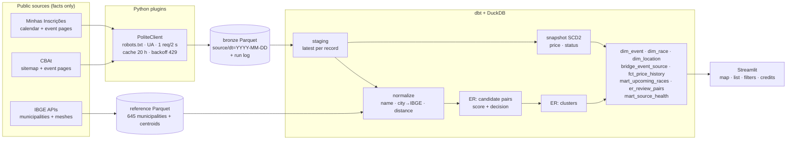
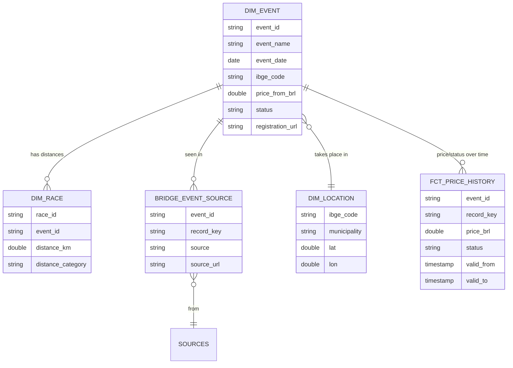

# 19 · Corridas de rua em SP: a small data warehouse of upcoming road races

Road races in Brazil are scattered across registration sites and calendars. This project collects the
**upcoming races in the state of São Paulo** from public pages, resolves duplicates into one record per
event, keeps the history of prices and status, and shows them on a map with distance, period, radius
and price filters.

> Weight: **light** (one Python container, DuckDB file). Personal, non-commercial study project.
> Collected data is never committed (`data/` is git-ignored).

---

## 1. What this example teaches

- **Responsible collection** from public pages: robots.txt, identified User-Agent, rate limit, daily cache,
  backoff on 429, allow-listed URLs, facts only — enforced in code and tested.
- A **plugin interface** for sources (`Source.collect() -> RaceRecord`) with parsers tested on saved HTML.
- **Bronze on Parquet** read in place by dbt-duckdb; staging keeps the newest observation per record.
- **Entity resolution in SQL**: blocking, similarity score, thresholds, review queue, clustering with a
  recursive CTE — explainable, no ML.
- **SCD type 2 with dbt snapshots** (price, status, date, distances) → price history.
- **Layout-break detection**: a scraper rarely fails loudly; it starts returning fewer or emptier rows.

## 2. Key concepts

| Concept | Here | Spark / Databricks analogy |
|---|---|---|
| External tables on files | dbt sources with `external_location: read_parquet(...)` | `CREATE TABLE ... USING parquet LOCATION` |
| Latest version per key | `qualify row_number() over (partition by source, id order by fetched_at desc) = 1` | dedup before `MERGE` |
| Blocking | candidate pairs only within the same municipality and ±1 day | the join key/bucketing step of any ER/dedup job |
| Connected components | recursive CTE label propagation (`int_er__clusters`) | GraphFrames `connectedComponents` |
| SCD2 | `snap_race_offer` (dbt snapshot, check strategy) | Delta `MERGE` with `valid_from/valid_to`, or DLT `APPLY CHANGES ... STORED AS SCD TYPE 2` |
| Data quality | dbt tests + source freshness + `mart_source_health` | DLT expectations / Lakehouse Monitoring |

## 3. Architecture



### Data model



## 4. How to run

```bash
make build
make run      # IBGE reference (once) -> collect sources -> dbt build   (first run ~15 min: polite pace)
make app      # http://localhost:8501
```

Daily: `make collect transform` (the cache makes a second run on the same day free for the sources).
`make test` runs the parser/HTTP tests; `make ci` builds the warehouse on synthetic data.

## 5. Exercises

1. Add a source plugin (e.g. a city hall calendar): implement `collect()`, save one page as a fixture, test it.
2. Tune the ER weights: label 30 pairs from `er_review_pairs` by hand and compute precision/recall.
3. "Price per km over time": chart `fct_price_history` for events with at least two versions.
4. Alert page: save a filter (distance, radius, period) and list events first seen after the last visit.
5. Climate: add Open-Meteo normals for each municipality and month (respecting its terms).

## 6. Interview questions

- How do you scrape responsibly — and how do you prove it (code, tests, docs)?
- Why block before scoring in entity resolution? What does it cost you?
- A scraper "works" but returns half the rows. How do you find out?
- Why a dbt snapshot instead of keeping all bronze files and diffing them?
- When is SQL-only ER good enough, and when would you move to a probabilistic model?

---

## Sources and compliance

**Collection policy** (enforced in `src/corridas/http.py` and the source plugins):

| Rule | How |
|---|---|
| Public pages only, no login | sources only read public URLs; no cookies, no accounts |
| No captcha or block bypassing | none attempted; a 403/blocked source is dropped, not worked around |
| robots.txt respected | checked before every page (RFC 9309: 4xx = no rules, 5xx = assume disallowed) |
| At most 1 collection per day per source | on-disk HTTP cache with a 20-hour TTL |
| Rate limit | at least 2 s between requests to the same host |
| Identified User-Agent | names the project and links to this repository |
| Facts only | event name, date, time, city, distances, price range, status, link. **No text, images or personal data** |
| Always keep the source link | `source_url` is `not_null`-tested and shown in the app with credit |

**Sources reviewed** (October 2026):

| Source | robots.txt | Terms | Decision |
|---|---|---|---|
| Minhas Inscrições | none published (404) | no terms of use page found; privacy policy only | **used**: calendar listing + event pages, numbers/flags only |
| CBAt | allows `/`, blocks `/api/`, `/pesquisa`, `/download-dados` | — | **used**: sitemap + event page header only (athlete tabs never read) |
| IBGE Localidades / Malhas | robots.txt returns 503 | public APIs for programmatic use | **used** through `get_api()` (robots.txt governs crawlers of pages; APIs follow their own terms) |
| Ticket Sports | allows `/`, blocks `/api/` | **purchase terms forbid reproducing any content without written permission** | **not used** |
| Sympla | allows `/` | public API covers only the organizer's own events | **not used** |
| Corridas BR | robots.txt returns 403 to robots | — | **not used** |
| Nominatim (OSM) | **disallows `/search` for all agents** | usage policy | **not used** — IBGE meshes give municipality centroids instead |

**Personal data (LGPD):** event pages can contain athletes (CBAt "ATLETAS" tab) and organizers' contact
e-mails inside free-form text. Extractors read specific elements or numbers only, bronze stores extracted
fields plus a hash of the page (never the HTML), and a test asserts that no text from a page with an
e-mail reaches the record.

**Click counters:** Minhas Inscrições links go through a click-tracking redirect. It is resolved once per
event (without following it) and the target URL is cached, so organizers' click statistics are not inflated.

## First run (26 Oct 2026)

| Step | Result |
|---|---|
| Minhas Inscrições collection | 155 in-person SP events in 10 min 51 s (polite pace: 1 request / 2 s) |
| CBAt collection | 44 events, 1 in SP — mostly championships; kept for large permit races |
| Fields extracted from free-form pages | distances 79%, price 74%, status 53%, start time 49% |
| Placeholder dates (e.g. 31/12/2050 on old pages still listed) | 60 records dropped (rule: event within 2 years) |
| Other sports / non-races (triathlon, aquathlon, open water, MTB, kids, courses, virtual) | excluded by name |
| Entity resolution | 23 candidate pairs → 2 auto-matches ("- Pix"/"- Cartão", "- Cartão"/"- Boleto e Pix"), 2 for review |
| Result | **85 upcoming events** in 36 municipalities, all on the map; 5k in 61, 10k in 40, 21k in 11, 42k in 5 |
| Entry price | median R$ 69.99 (min R$ 29, max R$ 200) |
| dbt | 49 nodes (models, snapshot, tests, unit tests), all passing, ~6 s |

Learning from the first run: Jaro-Winkler alone scored unrelated short names as similar
("Autismo em Movimento" × "Missão Selvagem Kamikaze Run" = 0.775). Averaging it with token Jaccard
cut the review queue from 10 to 2 pairs without losing the true matches.

## Production notes

- Schedule `make collect transform` daily (cron/Dagster); alert on `mart_source_health.health != 'ok'`.
- Move review decisions for ambiguous pairs into a small Postgres table read back by dbt.
- Credits: event data © the respective sources; municipality data © IBGE.
