# data-engineering-lab

Hands-on lab for the modern open-source data stack — **dbt, DuckDB, PostgreSQL, dlt, Kafka, Debezium, Spark Structured Streaming, Delta Lake, Airflow, Flink, data contracts, OpenLineage, Iceberg and Trino** — each one in a small, self-contained example that runs locally in Docker at zero cost.

Built as a study notebook by a data engineer coming from Databricks/Spark: every example explains the concepts, leaves exercises to implement, and lists interview questions on the topic.

## Roadmap

| # | Example | Key concepts | Weight | Status |
|---|---------|--------------|--------|--------|
| 01 | [dbt + DuckDB](01-dbt-duckdb/) | sources, staging/marts, materializations, tests, docs, snapshots (SCD2) | 🟢 light | in progress |
| 02 | [Postgres for data engineers](02-postgres-for-de/) | indexes, EXPLAIN ANALYZE, WAL, replication slots, partitioning | 🟢 light | todo |
| 03 | [Incremental API ingestion with dlt](03-dlt-incremental/) | incremental cursors, state, schema evolution, write dispositions | 🟢 light | todo |
| 04 | [Kafka fundamentals](04-kafka-basics/) | KRaft, topics, partitions, consumer groups, offsets, idempotent producer | 🟡 medium | todo |
| 05 | [CDC with Debezium](05-cdc-debezium/) | Postgres → Kafka, initial snapshot, updates/deletes, tombstones, outbox pattern | 🟡 medium | todo |
| 06 | [Spark Structured Streaming → Delta on MinIO](06-spark-streaming-delta/) | watermarks, foreachBatch + MERGE, checkpoints, exactly-once | 🔴 heavy | todo |
| 07 | [Airflow](07-airflow/) | idempotent DAGs, sensors, backfill, data intervals, LocalExecutor | 🔴 heavy | todo |
| 08 | [Data contracts + CI](08-data-contracts/) | datacontract-cli, schema/quality checks, breaking changes, GitHub Actions | 🟢 light | todo |
| 09 | [Flink fundamentals](09-flink-basics/) | Flink SQL, state, event-time windows, temporal joins | 🔴 heavy | todo |
| 10 | [Lineage with OpenLineage + Marquez](10-lineage-marquez/) | OpenLineage events, jobs/datasets/runs, dbt & Airflow integration | 🟡 medium | todo |
| 11 | [Capstone: end-to-end pipeline](11-capstone-e2e/) | Postgres → Debezium → Kafka → Spark → Delta → dbt, orchestrated by Airflow, lineage in Marquez | 🔴🔴 very heavy (lite profile available) | todo |
| 12 | [Iceberg + Trino (optional)](12-iceberg-trino/) | table format internals, catalogs, time travel, partition evolution | 🟡 medium | todo |

Weight = approximate RAM: 🟢 < 1 GB · 🟡 1–3 GB · 🔴 3–5 GB · 🔴🔴 8–10 GB.

```mermaid
flowchart LR
    A[01 dbt + DuckDB] --> B[02 Postgres]
    B --> C[03 dlt]
    C --> D[04 Kafka]
    D --> E[05 Debezium CDC]
    E --> F[06 Spark Streaming + Delta]
    F --> G[07 Airflow]
    G --> H[08 Data contracts]
    H --> I[09 Flink]
    I --> J[10 Lineage]
    J --> K[11 Capstone]
    K -.-> L[12 Iceberg + Trino]
```



## How the repo is organized

Every example folder is **fully independent** — later examples reuse ideas from earlier ones, but never depend on another folder to run.

```
NN-example-name/
├── docker-compose.yml   # minimal services for this example only
├── Makefile             # make up / make down / make run
├── README.md            # what it teaches, concepts, how to run, exercises, interview questions
└── NOTES.md             # personal notes: what broke and how it was fixed
```

## Prerequisites

- Docker Desktop (WSL2 backend on Windows) with Docker Compose v2
- `make`, `git`
- Python 3.12 + [uv](https://docs.astral.sh/uv/) for examples that run Python on the host

## Running an example

```bash
cd 01-dbt-duckdb
make up     # start the containers
make run    # run the example
make down   # stop everything and free resources
```

Run one example at a time — always `make down` before moving to the next.
