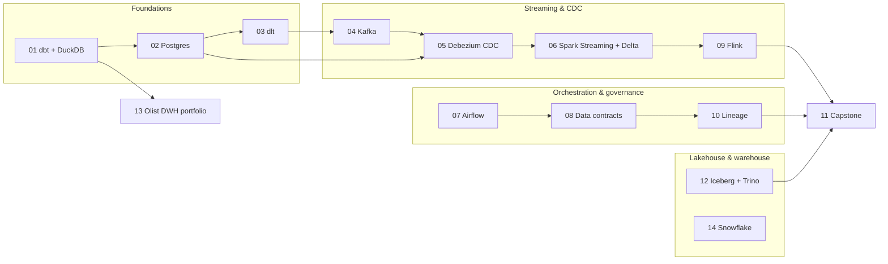

# data-engineering-lab

[](https://github.com/lucasfazzib/data-engineering-lab/actions/workflows/01-dbt-duckdb.yml)
[](https://github.com/lucasfazzib/data-engineering-lab/actions/workflows/13-olist-dwh.yml)
[](https://github.com/lucasfazzib/data-engineering-lab/actions/workflows/secret-scan.yml)

Hands-on lab for the modern data stack — **dbt, DuckDB, PostgreSQL, dlt, Kafka, Debezium, Spark Structured
Streaming, Delta Lake, Airflow, Flink, data contracts, OpenLineage, Iceberg, Trino and Snowflake** — each topic in a
small, self-contained example that runs locally in Docker at zero cost.

Every example explains the concepts (with analogies for people coming from Spark/Databricks), runs end to end,
leaves exercises to implement and lists the interview questions on the topic.

## Start here

- 🏆 **[13 — Olist e-commerce data warehouse](13-olist-data-warehouse/)**: a complete, production-style portfolio
  project on real data (Kaggle) — Kimball star schema in dbt, contracts, unit tests, data quality policy, ADRs,
  CI and a dashboard.
- 🧭 **[STUDY_GUIDE.md](STUDY_GUIDE.md)**: what data engineering roles ask for, how this repo maps to it, a 12-week
  plan, SQL / system-design / behavioral interview prep.

## Roadmap

| # | Example | Key concepts | Weight | Status |
|---|---------|--------------|--------|--------|
| 01 | [dbt + DuckDB](01-dbt-duckdb/) | sources, staging/marts, materializations, tests, docs, incremental, snapshots (SCD2) | 🟢 light | in progress |
| 02 | [Postgres for data engineers](02-postgres-for-de/) | EXPLAIN, indexes, MVCC/VACUUM, WAL, replication slots, partitioning, COPY/MERGE | 🟢 light | in progress |
| 03 | [Incremental API ingestion with dlt](03-dlt-incremental/) | pagination, rate limits, incremental cursors, state, merge, schema evolution | 🟢 light | in progress |
| 04 | [Kafka fundamentals](04-kafka-basics/) | KRaft, partitions, keys, consumer groups, offsets, delivery semantics, DLQ | 🟡 medium | in progress |
| 05 | [CDC with Debezium](05-cdc-debezium/) | Postgres → Kafka, snapshot, change envelope, tombstones, CDC sink, outbox | 🟡 medium | in progress |
| 06 | Spark Structured Streaming → Delta on S3 (MinIO) | watermarks, foreachBatch + MERGE, checkpoints, exactly-once | 🔴 heavy | todo |
| 07 | Airflow | idempotent DAGs, data intervals, sensors, backfill | 🔴 heavy | todo |
| 08 | Data contracts + CI | datacontract-cli, schema/quality checks, breaking changes | 🟢 light | todo |
| 09 | Flink fundamentals | Flink SQL, state, event-time windows, temporal joins | 🔴 heavy | todo |
| 10 | Lineage with OpenLineage + Marquez | jobs/datasets/runs, dbt & Airflow integration | 🟡 medium | todo |
| 11 | Capstone: end-to-end streaming lakehouse | Postgres → Debezium → Kafka → Spark → Delta → dbt, Airflow, lineage | 🔴🔴 very heavy | todo |
| 12 | Iceberg + Trino | table format internals, catalogs, time travel, partition evolution | 🟡 medium | todo |
| 13 | [**Olist data warehouse (portfolio)**](13-olist-data-warehouse/) | real data, Kimball, contracts, unit tests, DQ policy, ADRs, CI, dashboard | 🟢 light | done |
| 14 | Snowflake locally (fakesnow) + optional trial | Snowflake SQL, streams & tasks, dynamic tables, time travel, cost | 🟢 light | todo |
| 17 | [**Election night live (near real time)**](17-election-night-live/) | polling an overwrite-in-place feed, idempotent versions, bronze/silver Parquet, live dashboard, projection | 🟢 light | done |

Weight = approximate RAM: 🟢 < 1 GB · 🟡 1–3 GB · 🔴 3–5 GB · 🔴🔴 8–10 GB.
Status: **todo** → **in progress** (runs end to end, exercises open) → **done**.



## How the repo is organized

Every example folder is **fully independent** — later examples reuse ideas from earlier ones, but never depend on
another folder to run.

```
NN-example-name/
├── docker-compose.yml   # only the services this example needs, pinned versions, memory limits
├── Makefile             # make up / make run / make down (+ make help)
├── README.md            # what it teaches · key concepts · architecture · how to run · exercises · interview questions
└── NOTES.md             # learner's notebook: answers, what broke and how it was fixed
```

## Prerequisites

- Docker (Docker Desktop with the WSL2 backend on Windows) with Compose v2
- `make`, `git`, `curl`
- 8 GB RAM is enough for the light/medium examples; heavy ones are flagged

## Running an example

```bash
cd 01-dbt-duckdb
make up     # start the containers
make run    # run the guided demo
make down   # stop everything and free resources
```

Run one example at a time — several use the same ports (5432, 8080, 29092).

## Secrets and privacy

- No credentials are committed. Passwords in compose files are **local-only dummies** for throwaway containers.
- Anything real goes in git-ignored files (`.env`, `.dlt/secrets.toml`, `~/.dbt/profiles.yml`).
- Every push is scanned by [gitleaks](https://github.com/gitleaks/gitleaks) (`secret-scan` workflow).

## License

Code: [MIT](LICENSE). Datasets keep their own licenses — e.g. example 13 downloads the Olist dataset
(CC BY-NC-SA 4.0) at run time and does not redistribute it.
